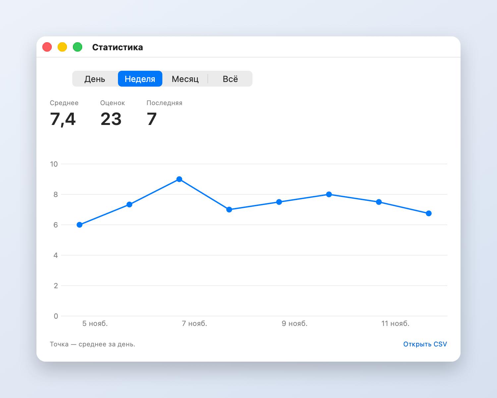

**График жизни** — маленькое приложение для Mac, которое живёт в строке меню и помогает замечать, как на самом деле проходит день.

**Что оно делает**

- Раз в несколько минут показывает поверх всех окон короткий вопрос из вашего списка, например «Какую задачу я решаю?». Он возвращает внимание к главному.
- Время от времени просит оценить состояние звёздами от 1 до 10 и в двух словах написать почему. Достаточно одного клика, комментарий необязателен.
- Собирает оценки в график: видно, как менялось состояние по дням и что на него влияло.

Всё хранится только на вашем Mac. Новые версии приходят и ставятся сами.

**Как установить**

1. Скачайте [GraphOfLife.dmg](https://github.com/pdllmsk/graph-of-life/releases/latest/download/GraphOfLife.dmg) и откройте его.
2. Перетащите «График жизни» на папку «Программы» в том же окне.
3. Откройте приложение из «Программ». macOS скажет, что не может проверить разработчика. Нажмите «Готово».
4. Откройте «Системные настройки», раздел «Конфиденциальность и безопасность». Внизу рядом с «График жизни» нажмите «Всё равно открыть» и подтвердите. Это нужно только один раз.

**Как пользоваться**

В строке меню вверху справа появится белый квадратик с чёрной чертой. В его меню можно показать вопрос сразу, оценить состояние, открыть статистику и настройки. В настройках меняются вопросы, частота показа, вид плашки и то, как часто спрашивать оценку.

Нужна macOS 14 или новее, подходят Mac на Apple и на Intel.
