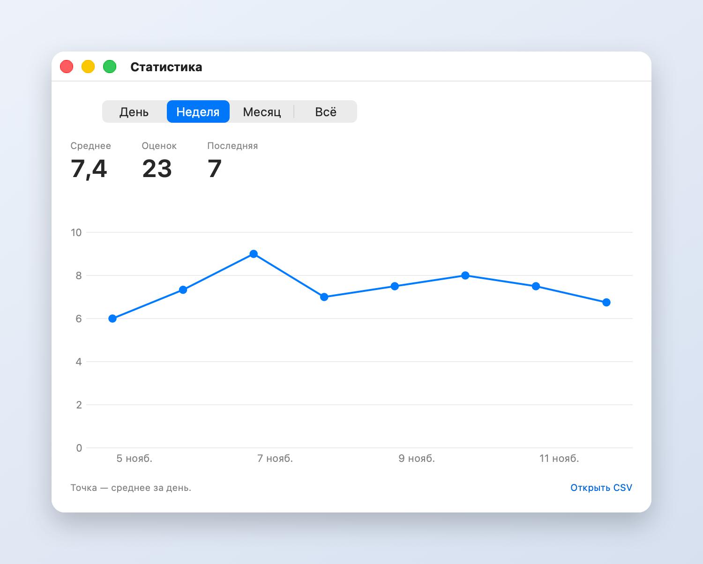
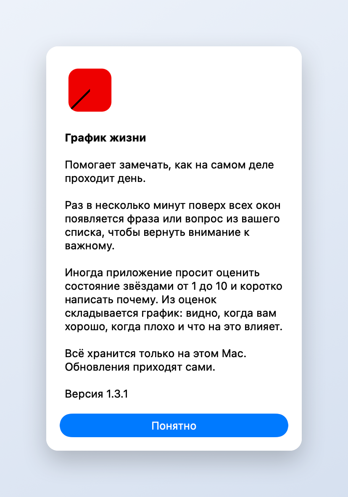

# График жизни

Приложение для macOS в строке меню. Раз в несколько минут поверх всех окон показывает фразу или вопрос из вашего списка, а время от времени просит оценить состояние по пяти звёздам с половинками. Оценки и комментарии собираются в график.

Скачать: [GraphOfLife.dmg](https://github.com/pdllmsk/graph-of-life/releases/latest/download/GraphOfLife.dmg). Установка описана в [INSTALL.md](INSTALL.md).

## Как это выглядит

**Оценка состояния.** Пять звёзд, каждая делится пополам: клик даёт оценку от 1 до 10. Потом можно коротко написать почему, курсор уже стоит в поле.

**Статистика.** Оценки собираются в график за день, неделю, месяц или всё время. При наведении видны средний балл и комментарии.

**О приложении.** Короткая сводка прямо в меню.

## Разработка

- `./build.sh` собирает `График жизни.app` (универсальная сборка, Sparkle скачивается и проверяется сам).
- `./release.sh 1.1 "Что изменилось"` выпускает версию на GitHub. Установленные копии обновятся сами через Sparkle.
- `./tools/screenshots/make.sh` пересобирает картинки в `docs/screenshots` на выдуманных данных.

Для выпуска нужен ключ подписи обновлений в `~/.config/graph-of-life/sparkle-private-key`. Его копия хранится в связке ключей macOS под именем `graph-of-life`. Без этого ключа выпустить обновление для уже установленных копий нельзя.

Данные пользователя лежат в `~/Library/Application Support/Nudge`, настройки в `defaults` под `local.nudge`.
